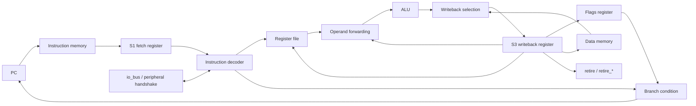

# DSD-8 Design Report

## 1. Design scope

This report documents the implementation present in `rtl/dsd8_cpu.v`. The
processor uses a three-stage in-order pipeline with a combinational fetch
interface and an internal fetch/decode-execute/writeback sequence. Public
module ports remain unchanged. The supplied `tb/tb_dsd8.v` is not modified.

The local checkout did not contain
`DSD8-Processor-Project-Specification.pdf`; the report therefore records
signals and behavior read directly from RTL and does not claim a line-by-line
comparison against the unavailable PDF.

## 2. Microarchitecture

1. **IF / S1** — `pc` drives `imem_addr`; `imem_data` is combinational from
   instruction memory. At the active clock edge, `s1_pc`, `s1_ir`, and
   `s1_valid` capture the fetched instruction.
2. **ID/EX / S2** — `s2_pc`, `s2_ir`, and `s2_valid` hold the decoded
   instruction. `instr_decoder` extracts fields; the register file supplies
   operands, forwarding selects pending S3 data, and the ALU, branch decoder,
   load/store address/data selection, or I/O request is evaluated.
3. **EX/WB / S3** — `s3_*` holds the execution result and side-effect enables.
   The register file, flags register, and data memory commit from this stage.
   The `retire_*` interface reports the in-order instruction at S3.

In the RTL, the field names `s1_*`, `s2_*`, and `s3_*` refer to sequential
pipeline state; the ALU is combinational from S2 and its values are captured
into S3.

## 3. Implemented control behavior

The following table describes the inline decode in `dsd8_cpu.v` (not the
standalone `control_unit` module, which the CPU does not instantiate).

| S2 opcode | RF write | Memory write | Flags write | writeback select | PC action / other |
|---|---:|---:|---:|---|---|
| NOP / default | 0 | 0 | 0 | ALU/default | Sequential |
| LDI | 1 | 0 | 0 | `s2_imm8` | Sequential |
| LD | 1 | 0 | 0 | `dmem_rdata` | Sequential |
| ST | 0 | 1 | 0 | — | Address from forwarded `a`; store data from forwarded `b`/rd |
| ADD, SUB, AND, OR, XOR, SHL, SHR | 1 | 0 | 1 | ALU | Sequential |
| CMP | 0 | 0 | 1 | — | Sequential |
| JMP | 0 | 0 | 0 | — | `branch_taken=1`, load `s2_addr9` |
| Bcc | 0 | 0 | 0 | — | Compare selected `branch_flags`; load target only when true |
| IN | 1 | 0 | 0 | `io_rdata` | I/O request; stalls while `!io_ready` |
| OUT | 0 | 0 | 0 | — | I/O write request; stalls while `!io_ready` |
| HLT | 0 | 0 | 0 | — | Latches `halted_r`; drains S3 before public `halted` |

`retire_rf_addr/data`, `retire_mem_addr/data`, and the RF/memory enable outputs
are masked to zero when their matching side-effect enable is false. When a
valid S3 entry has no new flag write, `retire_flags` reports the current
architectural flags.

The separate `control_unit` module is not instantiated by `dsd8_cpu`; its
combinational interface has no instruction-valid input or IN/OUT direction
input, and its `retire` output is not used by the processor. Its standalone
unit test checks only the implemented combinational decode. System retirement
is provided by the CPU pipeline's `s3_valid` path.

## 4. Hazards and flow control

- **RAW register forwarding:** when an S3 RF write targets either S2 source,
  the CPU selects `s3_rf_data` instead of the asynchronous register-file read
  for operand `a` or `b`. The RF itself retains old-value-before-write
  behavior.
- **Load-use detection:** `load_use_stall` checks the current fetched word's
  register fields against the destination of an S2 load and holds the fetch
  and S2 state while the load moves through writeback. The detector is
  conservative: it compares all three candidate register fields without
  decoding whether each field is a source for the fetched opcode. This can
  insert an unnecessary stall; the current directed program set does not
  establish a complete false-stall/forwarding matrix.
- **Branch flags:** a branch sees `s3_flags` if a valid flag-setting operation
  is pending in S3, otherwise `flags_out`. This resolves the adjacent
  flag-producer/branch dependency.
- **Branch flush:** a taken branch redirects `pc` and clears `s1_valid` and
  `s2_valid`, leaving the branch itself to advance to S3 and retire.
- **I/O stall:** `io_stall = io_request && !io_ready`. PC and S1/S2 values
  hold; the request fields remain driven from the held S2 instruction. The
  pending retirement pulse is suppressed while stalled and emitted after
  readiness returns.
- **HLT drain:** HLT sets `halted_r` when it is processed from S2. Public
  `halted` waits for `s3_valid` to clear, allowing HLT to retire first.

## 5. Design-decision record

| decision | chosen approach | rejected alternative | rationale / trade-off |
|---|---|---|---|
| Pipeline depth | Three sequential entries with combinational decode/execute between S2 and S3. | A single-cycle path or an added memory stage. | Matches the project's requested three-stage core without changing the frozen interface. |
| Instruction memory read | Combinational ROM read; capture instruction in S1. | Registered ROM read with a changed fetch schedule. | Keeps the PC/IMEM relationship simple and preserves the existing harness timing. |
| Register-file write timing | S3 writes on the clock edge; read ports remain combinational with no write-through inside the RF. | Internal asynchronous write-through in the RF. | Preserves old-value read semantics; bypassing belongs in the CPU pipeline. |
| RAW resolution | Forward S3 result into S2 operands. | Stall on every producer-consumer pair. | Allows adjacent ALU dependencies to proceed without a general data interlock. |
| Branch flag dependency | Forward pending S3 flags to S2 branch evaluation. | Delay branches until `flags_out` updates. | Resolves the latest flag producer without changing instruction encoding or adding a pipeline stage. |
| Data-memory initialization | Initialize all 256 bytes to zero in `data_memory`. | Add a 256-cycle reset scrub FSM. | The frozen DMEM interface has no reset input; initialization avoids extra startup cycles, with FPGA initialization portability as a trade-off. |
| I/O backpressure | Hold the pipeline request until `io_ready`; suppress duplicate retire while held. | Assume all peripherals complete in one cycle. | Required for SLOW_ECHO and other variable-latency peripherals. |
| Standalone control unit | Retain module, but use CPU-local decode in the integrated core. | Integrate it by changing CPU wiring or its ports. | Avoids an unverified port/microarchitecture change; the module is currently standalone and should not be mistaken for the active CPU controller. |

## 6. Oral-defense focus

Be prepared to trace one adjacent ALU dependency through S2/S3 forwarding,
explain why the RF itself has no write-through, show which flag source a
branch uses, and identify which state is held during an I/O wait. Also note
that `prog_counter` and `control_unit` are present but unused by `dsd8_cpu`;
the active PC and decode controls are implemented inline.
